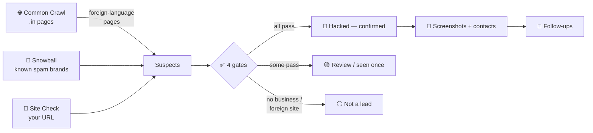

<div align="center">

# 🛡️ SiteWatch India

### Find hacked Indian websites, prove it with evidence, and help the owners clean them up.

[](LICENSE)


**Free · Open source · Runs on your laptop · No AI subscription · No paid API**

[Quick start](#-quick-start) · [How to use](#-how-to-use) · [How it works](#-how-it-works) · [Fix a hacked site](#-how-owners-can-fix-a-hacked-site) · [Responsible use](#-responsible-use)

</div>

---

## 😟 The problem

Thousands of small Indian business websites (`.in`, `.co.in`, `.ac.in`, `.gov.in` and Indian `.com` sites) have been **quietly hijacked**.

- The owner opens the homepage, and **everything looks normal**.
- But **Google, mobile visitors, or hidden inner pages** show Indonesian, Thai or Vietnamese **gambling spam** ("slot", "togel", "judi") or other junk.
- The owner usually **has no idea**, while their Google ranking falls, customers lose trust, and some ISPs block the site completely.

## 💡 What SiteWatch does

> **We find these sites, prove they were hacked with public evidence, and help you reach the owner so the site gets fixed.**

| | |
|---|---|
| 🔎 **Discover** | Scans the free monthly public web crawl (Common Crawl) for Indian sites that show foreign-language spam |
| ✅ **Verify** | 4 independent checks before anything is called "hacked". Few false alarms |
| 📸 **Prove** | Before/after screenshots: the clean archived copy next to today's spam |
| 📇 **Contact** | Collects only the contact details the owner **published themselves** |
| 📅 **Follow up** | Log calls, emails and WhatsApp messages, set reminders, see what's overdue |
| 🧠 **Learn** | Mark a false positive and the app suggests a rule so similar sites are skipped |

### ✨ Highlights

- 🌐 **Any platform:** WordPress, Joomla, Drupal, custom PHP, static sites and more
- 🕵️ **Catches hidden hacks:** fetches every page as a browser, as Googlebot, as a mobile browser and with a Google referrer
- 🧩 **Dynamic, not a static keyword list:** it notices when a page's language doesn't belong to the site and learns spam brand names from real victims
- 💻 **One local app:** a dashboard, Site Check, Leads, Follow-ups, Rules, Reports and charts
- 📦 **Easy to share:** zip the folder, and the other person runs `python server.py`

---

## 🚀 Quick start

**You need:** Python 3.10 or newer (tested on 3.13), on Windows, macOS or Linux.

```bash
# 1. Get the code
git clone https://github.com/Mariappan-KM/websitecheck.git
cd websitecheck

# 2. Install (one time)
pip install -r requirements.txt
python -m playwright install chromium

# 3. Start
python server.py
```

Open 👉 **http://127.0.0.1:8790**

> 🪟 **Windows shortcut:** just double-click **`start.bat`**. It starts the server and opens the browser.

<details>
<summary><b>More options</b></summary>

| Need | How |
|---|---|
| Use another port | `SITEWATCH_PORT=9000 python server.py` · PowerShell: `$env:SITEWATCH_PORT=9000; python server.py` |
| Stop the server | Press `Ctrl+C` in the server window |
| Just browse saved results | Open `preview/index.html` directly (Search and Site Check need the server) |
| Better discovery (optional) | Get a **free** [urlscan.io](https://urlscan.io) key and put `URLSCAN_API_KEY=...` in `research/.env` (git-ignored, never commit it) |
| After updating the code | Restart the server, then press `Ctrl+F5` in the browser |

</details>

---

## 🧭 How to use

### 1️⃣ Check one website
Open **Site Check**, type `example.in` or a full page URL, and click **Check website**.
In a few minutes you get the verdict, screenshots, evidence and contact details. Add more sites and they queue up automatically (up to 20).

### 2️⃣ Find new hacked sites
Click **🔍 Search** in the top bar. The default values are already filled in, so just press start.
When it finishes you get a report like: *"Searched 400 sites · 52 suspicious · 9 hacked"*. Choose **"Since today"** to see only new finds.

### 3️⃣ Review the evidence
Go to **Leads** and open a site to see the proof, screenshots and the 4 checks.
Use the filters: *Hacked — confirmed*, *Review*, *Unreachable*, *Page not found*, spam brand, and more.
Something wrong? Click **Mark false positive** and accept the suggested rule.

### 4️⃣ Approve and follow up
Approve the real ones, then log every contact in the **Follow-up** box (status, note, next date).
The **Follow-ups** page shows what's overdue, due today, upcoming and not yet scheduled.

<details>
<summary><b>⌨️ Command-line usage (advanced)</b></summary>

Run these from the `research/` folder:

```bash
python collect_commoncrawl.py CC-MAIN-2026-43 400 --langs=ind,tha,vie,msa --tld=in   # discover
python snowball.py                                                                  # same spam brand on other sites
python verify.py candidates_new.json --new-only                                     # 4-gate verification
python capture.py                                                                   # screenshots
python check_site.py https://example.in/some-page                                   # one site, full report
```

`400` = maximum domains to check. Raise it (for example `3200`) to cover every suspect in a crawl.

</details>

---

## ⚙️ How it works



### The 4 gates

A site is marked **🚨 Hacked — confirmed** only when **all four** pass:

| Gate | Question it answers |
|---|---|
| **G1 · Past business** | Did the Wayback Machine show a real business here before? |
| **G2 · No registration gap** | Was the domain registered *before* its last clean copy, so it wasn't simply re-bought by spammers? |
| **G3 · Old assets live** | Is the owner's own homepage or original files still live on the same site? |
| **G4 · Seen twice** | Was the spam seen on two different days? |

🛑 **Extra guards** keep these out of your leads: sites that were foreign-language from the start, spammer-owned domains, free-hosting platforms, ISP block pages, and sites without a strong India signal.

### Verdicts

`🚨 Hacked — confirmed` · `🟠 Hacked — seen once (confirm tomorrow)` · `🟡 Review` · `🕘 Was hacked (spam gone)` · `🔗 Page not found` · `☁️ Unreachable` · `⛔ Blocked by ISP` · `✅ Clean` · `⚪ Not a lead`

---

## 🧹 How owners can fix a hacked site

Share this checklist with the site owner or their developer:

1. 💾 **Back up** the site files and database first.
2. 🔑 **Change every password:** hosting/cPanel, FTP/SFTP, database, CMS admins and email. Remove admin users you don't know.
3. 🔍 **Find the injected content:** unknown files and folders (often random names, or pages in Indonesian), and changes to `.htaccess`, `index.php` or `wp-config.php`. Look for code that shows different content to Googlebot or mobile visitors.
4. ⬆️ **Update everything:** the CMS core, themes and plugins. **Delete "nulled" (pirated) and unused plugins and themes**, because they are the #1 way in.
5. ♻️ **Clean up or restore** from a known clean backup, then **re-check with SiteWatch Site Check**.
6. 🧾 **Clean up Google:** in Search Console, check *Security issues*, remove spam URLs, submit a fresh sitemap and request a review.
7. 🛡️ **Stay safe:** turn on automatic updates, 2-factor login, a firewall (WAF) and regular off-site backups.

---

## 🤝 Responsible use

This tool deals with **real businesses and real people**. Please:

- ✅ Look at **public pages only**. Never probe log-ins, private paths or anything that needs a password.
- ✅ Contact owners only through details **they published themselves**. Respect India's DND/TRAI rules and **email first**.
- ✅ **Check the evidence yourself** before contacting anyone. A verdict is a strong signal, not a guarantee.
- ✅ Be honest and helpful: show the screenshots and explain what you found.
- ❌ **Never publish lists of victim sites.** Share findings only with the site's owner.
- ❌ Never use fear or pressure to sell a cleanup.

---

## 📁 Project layout

```
websitecheck/
├── server.py            local web server + API (Search, Site Check, reports)
├── start.bat            Windows one-click launcher
├── requirements.txt     duckdb, playwright
├── preview/             the web app (index.html, core.js, app.js) + data it reads
├── research/            collectors, verifier, screenshots, single-site checker
└── Agent.md             detailed design and logic notes
```

## ⚠️ Limits

- Common Crawl is a **sample**: about 220,000 `.in` domains per monthly crawl, not every registered site.
- **English-language spam** is caught only by the snowball step and Site Check.
- Indian **`.com`** sites can't be found by the domain ending alone.
- The Wayback Machine and RDAP are sometimes slow, which can turn a result into *Review*. Just re-check later.

## 🌱 Contributing

Contributions are very welcome! Good places to start:

- 🧪 New detection signals, or ways to **reduce false positives**
- 🌍 Support for **other countries and languages**
- 📖 Cleanup guides for more platforms (Joomla, Drupal, Magento …)
- 🎨 UI improvements and accessibility

Fork the repo, create a branch, and open a pull request. When you report a wrong verdict, explain **why** the logic got it wrong, and share real victim sites **privately**, not in public issues.

## 📜 License

Released under the **[MIT License](LICENSE)**: free to use, copy, modify and share, including commercially. Just keep the copyright notice.

© 2026 Mariappan KM

<div align="center">

**If this project helps a business get its website back, give it a ⭐**

</div>
